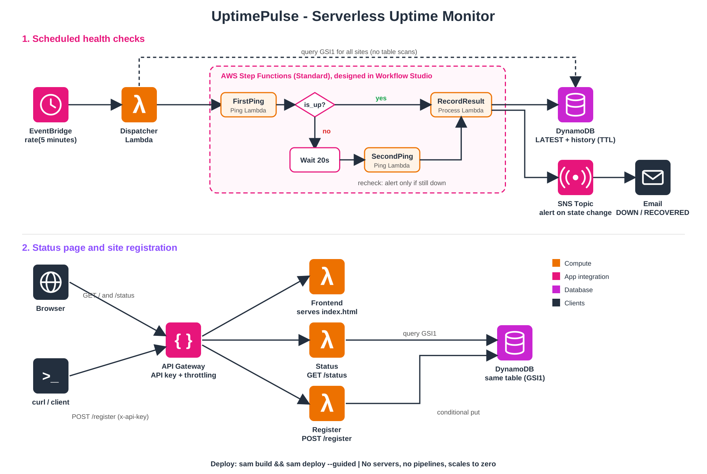

   # UptimePulse

   

Serverless website uptime monitor. No servers, no pipelines.

**Services:** EventBridge, Lambda, Step Functions, DynamoDB (GSI + TTL), SNS, API Gateway.

**Live status page:** https://nupzqdko90.execute-api.us-east-1.amazonaws.com/Prod/

## How it works
1. EventBridge triggers the Dispatcher Lambda every 5 minutes.
2. Dispatcher queries DynamoDB (GSI, no scans) and starts one Step Functions execution per site.
3. Step Functions pings the site. If it fails, it waits 20s and rechecks.
4. Process Lambda stores LATEST + history (7-day TTL) and sends an SNS email only on UP<->DOWN change, with downtime duration on recovery.
5. API Gateway serves the status page (Lambda) and /status; POST /register needs an API key and is throttled.

## Deploy
    sam build
    sam deploy --guided      # enter your AlertEmail, then confirm the SNS email

## Get API key and register a site
    aws apigateway get-api-key --api-key <ApiKeyId output> --include-value --query value --output text
    curl -X POST "<RegisterUrl output>" -H "Content-Type: application/json" -H "x-api-key: <KEY>" -d '{"url":"https://aws.amazon.com"}'

## How to reuse
Clone, `sam build && sam deploy --guided`, register your own URLs. Cost: pennies a month.
"# uptime-pulse" 
